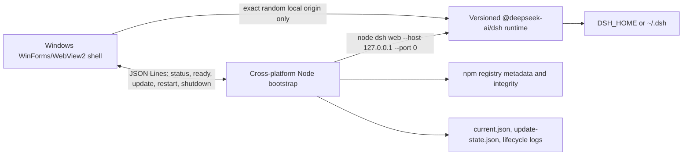

# Architecture

The Windows host owns desktop-only behavior: single instance, native chrome,
menus, tray, WebView2, exact-origin navigation, and best-effort DOM adapters.
It does not install or invoke dsh directly.

The Node bootstrap owns all portable runtime behavior: immutable version
directories, npm metadata checks, install staging, backend process lifetime,
health checks, atomic activation, rollback, and JSON Lines protocol. Future
macOS/Linux hosts can launch the same entry point without Windows APIs.

Protocol output types are `status`, `ready`, `update-available`, and `fatal`.
Commands are `update`, `restart`, `check-update`, and `shutdown`. Standard
output is reserved for one JSON object per line; dsh output is consumed by the
bootstrap and only startup lifecycle information reaches its redacted log.
